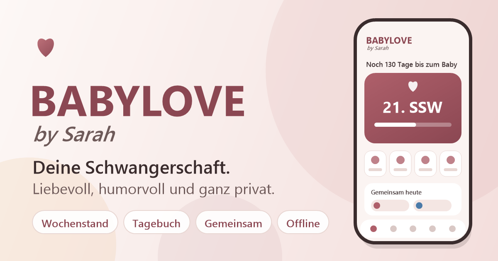

# BABYLOVE by Sarah: Deine Schwangerschaft, liebevoll und humorvoll

**Ein Begleiter für deine Schwangerschaft: mit Wochenstand, gemeinsamem Tagebuch, kleinen Ritualen für euch beide und vielen Mutmachern.** Mit Liebe, Humor und Motivation, privat und offline: Alle Daten bleiben nur auf deinem Gerät.

## [Jetzt starten: nosz.github.io/babylove](https://nosz.github.io/babylove/)

Kostenlos, ohne Konto, läuft im Browser auf Handy, Tablet und Computer und lässt sich wie eine App installieren.

## Was dich erwartet
- **Wochenstand und Partner-Modus:** was gerade im Bauch passiert und wie der Partner richtig gut unterstützt.
- **Erinnern:** Tagebuch, Fotoalbum, Briefe ans Baby (Text oder Sprachnachricht), Meilensteine und Wochen-Story zum Teilen.
- **Körper und Wohlbefinden:** Bewegung, Yoga für Schwangere, Atemübungen, Ernährung mit Kochrezepten, Vitamine und Wasser-Tracker.
- **Vorbereiten:** Checklisten für Kliniktasche und Erstausstattung, Wunschliste, Namensfinder, Planer, Kontakte und digitaler Mutterpass.
- **Zum Schmunzeln:** Babywitze und viele kleine Mutmacher; später ein Baby-Tracker für Stillen, Windeln und Schlaf.
- **Deine Farben, dein Name:** Aussehen und App-Name lassen sich anpassen; PIN-Sperre und Datensicherung sind eingebaut.
- **Empfehlungen:** weitere kleine Apps in den Einstellungen, zum Beispiel [Herzintelligenz](https://nosz.github.io/herzintelligenz/), die Energietankstelle und die Mutigen Kinderherzen.

## Installieren
- **Android (Chrome):** Menü, „App installieren“.
- **iPhone (Safari):** Teilen-Symbol, „Zum Home-Bildschirm“. Die App erklärt es dir auch selbst.
- Danach funktioniert sie auch ohne Internet.

## Gut zu wissen
- Die Inhalte zu Gesundheit und Ernährung stammen aus allgemeinen Quellen und ersetzen keine Beratung durch Frauenarzt oder Hebamme.
- Notrufnummern und Anlaufstellen ohne Gewähr; bitte für deine Region prüfen.
- Deine Daten liegen nur auf deinem Gerät. Mit der Datensicherung nimmst du sie auf ein neues Handy mit.

**BABYLOVE by Sarah** · Version 2.8.9 (23.10.2026)